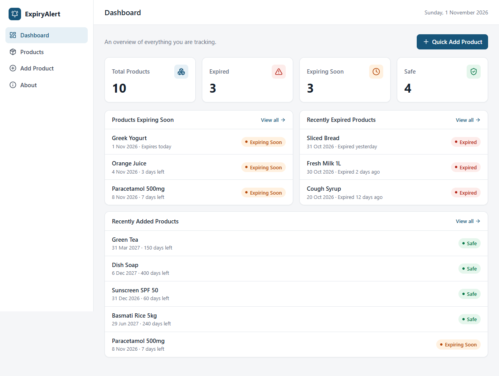
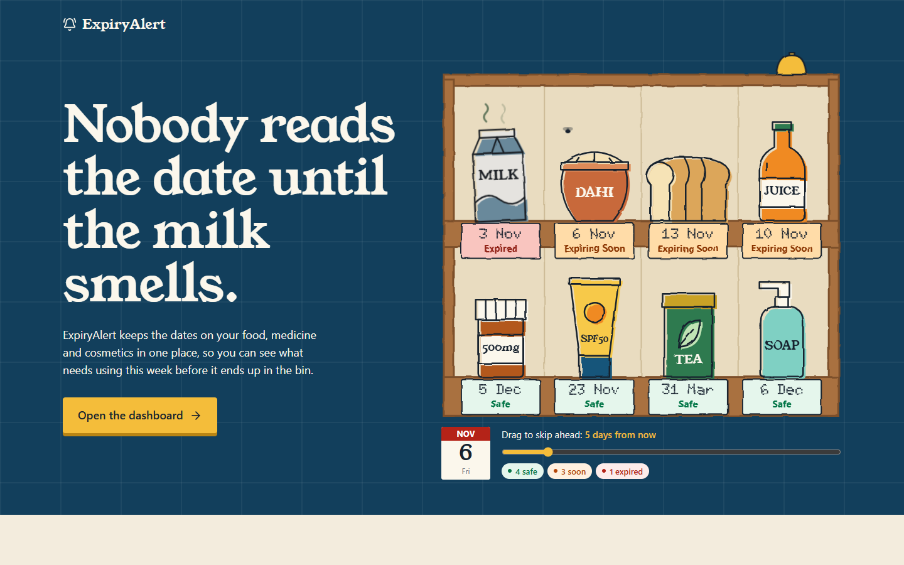
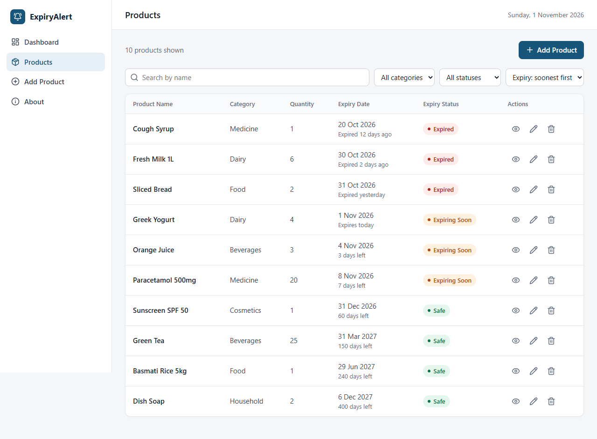
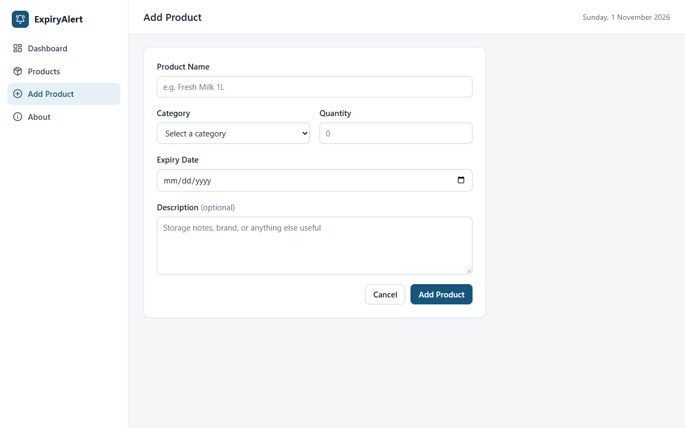
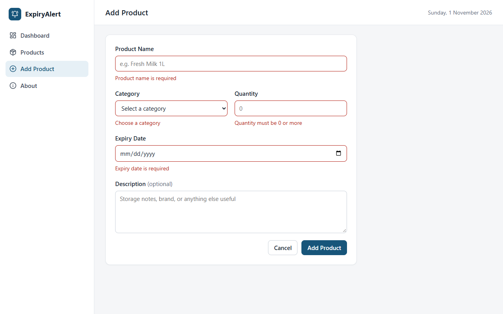
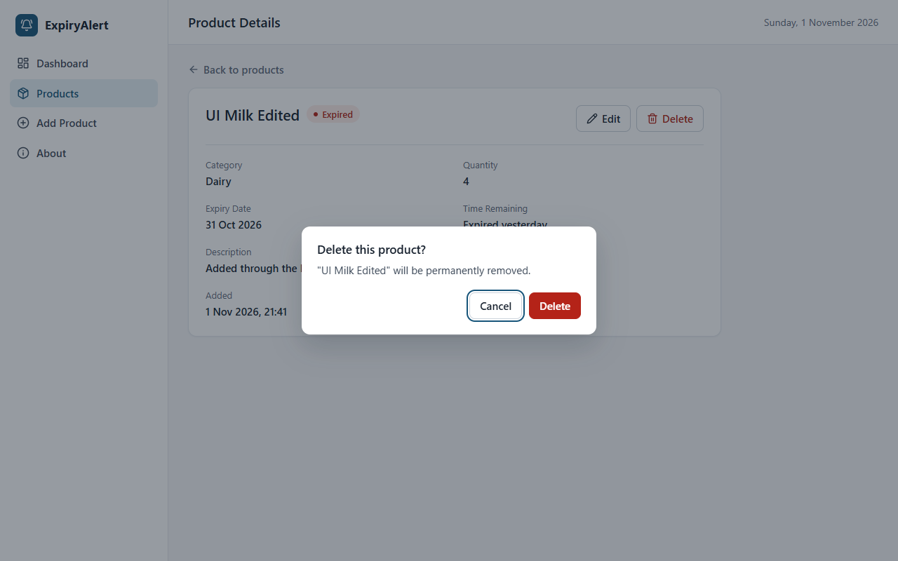
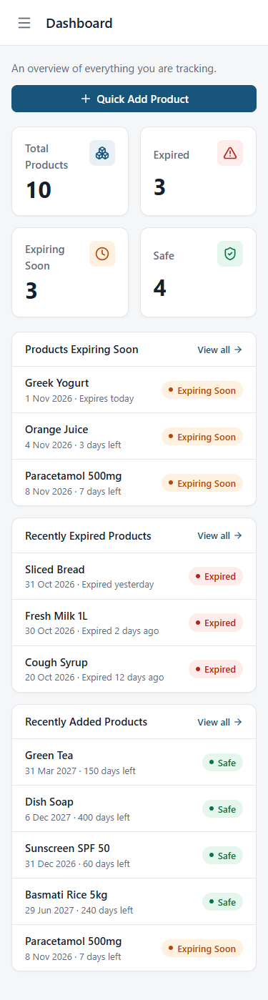

# ExpiryAlert

ExpiryAlert is a product expiry tracking web application built with the MERN Stack (MongoDB, Express.js, React and Node.js). Users can add products, see which ones are expired or expiring soon, and manage everything from one dashboard.



## Problem Statement

People often forget the expiry dates of food, dairy products, beverages, medicines, cosmetics and household items. Expired products get used by mistake, and products that could have been used in time go to waste. Checking every item by hand is slow and easy to forget.

## Project Objectives

- Store product information in a MongoDB database.
- Provide full Create, Read, Update and Delete (CRUD) operations through a REST API.
- Calculate each product's expiry status automatically from the current date.
- Show live statistics on a dashboard.
- Let users search, filter and sort their products.
- Provide a clean, responsive interface for desktop, tablet and mobile.

## Features

- **Landing page:** an animated pantry shelf with a date slider that shows how products move from Safe to Expired, plus a button that opens the dashboard.
- **Dashboard:** total, expired, expiring soon and safe counts, plus recently added, expiring soon and recently expired lists.
- **Product management:** a table with view, edit and delete actions.
- **Add and edit forms:** validation on both the frontend and the backend.
- **Delete confirmation:** a dialog appears before anything is removed.
- **Search, filter and sort:** by name, category, expiry status and expiry date.
- **User feedback:** loading, empty and error states, with a retry option when loading fails.

## Technology Stack

| Layer | Technology | Purpose |
|---|---|---|
| Frontend | React with Vite | User interface |
| Routing | React Router DOM | Page navigation without reloading |
| HTTP client | Axios | Sends requests to the API |
| Icons | Lucide React | Interface icons |
| Fonts | Fontsource (Young Serif, Doto) | Landing page typefaces, bundled so they work offline |
| Backend | Node.js with Express.js | REST API |
| Database | MongoDB | Stores the products |
| Data modelling | Mongoose | Schema, validation and queries |

## MERN Architecture

```text
Browser (React, port 5173)
      |   Axios sends HTTP requests with JSON
      v
Express server (port 5000)
      |   route -> controller -> Mongoose model
      v
MongoDB (port 27017, database: expiryAlert)
```

1. The user does something in React, such as submitting the Add Product form.
2. `services/api.js` sends an HTTP request with Axios.
3. Express matches the URL to a route, and the route calls a controller function.
4. The controller validates the data and uses the Mongoose model to talk to MongoDB.
5. Express returns a JSON response, and React updates the page.

## Project Structure

```text
expiry-alert/
├── backend/
│   ├── config/db.js              MongoDB connection
│   ├── controllers/              Application logic
│   ├── middleware/               Database check and error handling
│   ├── models/Product.js         Mongoose schema
│   ├── routes/                   URL to controller mapping
│   ├── scripts/seed.js           Optional sample test data
│   ├── tests/expiry.test.js      Unit tests for the expiry rules
│   ├── utils/expiry.js           Expiry status and date rules
│   └── server.js                 Application entry point
├── frontend/
│   └── src/
│       ├── components/           Reusable interface pieces
│       ├── pages/                One component per page
│       ├── services/api.js       All API requests
│       ├── utils/product.js      Categories and date formatting
│       ├── App.jsx               Layout and routes
│       └── main.jsx              React entry point
└── docs/
    ├── CODE_GUIDE.md             What each file does
    ├── PRESENTATION.md           Presentation talking points
    └── screenshots/
```

## Database Schema

**Database:** `expiryAlert`  **Collection:** `products`

| Field | Type | Rules |
|---|---|---|
| `_id` | ObjectId | Created automatically by MongoDB |
| `name` | String | Required, trimmed, up to 100 characters |
| `category` | String | Required, must be an allowed category |
| `quantity` | Number | Required, 0 or more |
| `expiryDate` | Date | Required |
| `description` | String | Optional, up to 500 characters |
| `createdAt` | Date | Managed by Mongoose timestamps |
| `updatedAt` | Date | Managed by Mongoose timestamps |

**Allowed categories:** Food, Dairy, Beverages, Medicine, Cosmetics, Household, Other.

Expiry status is deliberately **not** stored. A saved "Safe" value would become wrong as days pass, so the status is calculated whenever it is needed.

## Expiry Status Logic

| Status | Rule |
|---|---|
| Expired | The expiry date is before today |
| Expiring Soon | The expiry date is today or within the next 7 days |
| Safe | More than 7 days remain |

An expiry date has no time of day, so each one is stored as midnight UTC of that calendar date. "Today" is taken from Nepal's calendar (UTC+5:45), so the status changes at midnight in Nepal whatever timezone the server uses. The same rules in `backend/utils/expiry.js` power the tables, filters and dashboard counts.

## CRUD Operations

| Operation | HTTP method | Mongoose method | Where it is used |
|---|---|---|---|
| Create | POST | `Product.create()` | Add Product form |
| Read | GET | `Product.find()`, `Product.findById()` | Dashboard, Products, Product Details |
| Update | PUT | `Product.findByIdAndUpdate()` | Edit Product form |
| Delete | DELETE | `Product.findByIdAndDelete()` | Delete buttons |

## API Documentation

**Base URL:** `http://localhost:5000/api`

### Products

| Method | Endpoint | Purpose | Success |
|---|---|---|---|
| POST | `/products` | Create a product | 201 |
| GET | `/products` | Get products | 200 |
| GET | `/products/:id` | Get one product | 200 |
| PUT | `/products/:id` | Replace a product's details | 200 |
| DELETE | `/products/:id` | Delete a product | 200 |

`GET /products` accepts these optional query parameters, which can be combined:

| Parameter | Example | Meaning |
|---|---|---|
| `search` | `?search=milk` | Name contains the text, ignoring case |
| `category` | `?category=Dairy` | Exact category |
| `status` | `?status=Expiring%20Soon` | `Expired`, `Expiring Soon` or `Safe` |
| `sort` | `?sort=desc` | Expiry date order: `asc` (default) or `desc` |

### Dashboard

| Method | Endpoint | Purpose |
|---|---|---|
| GET | `/dashboard/stats` | Total, expired, expiring soon and safe counts |
| GET | `/dashboard/expiring` | Five products expiring soonest |
| GET | `/dashboard/expired` | Five most recently expired products |
| GET | `/dashboard/recent` | Five most recently added products |

### Example request and response

`POST /api/products`

```json
{
  "name": "Fresh Milk",
  "category": "Dairy",
  "quantity": 2,
  "expiryDate": "2026-11-05",
  "description": "Kept in the fridge"
}
```

Response with status `201`:

```json
{
  "success": true,
  "message": "Product created successfully",
  "result": {
    "_id": "6ae75fd9b74b025af93af52e",
    "name": "Fresh Milk",
    "category": "Dairy",
    "quantity": 2,
    "expiryDate": "2026-11-05T00:00:00.000Z",
    "description": "Kept in the fridge",
    "createdAt": "2026-11-01T15:52:00.000Z",
    "updatedAt": "2026-11-01T15:52:00.000Z",
    "daysLeft": 4,
    "status": "Expiring Soon"
  }
}
```

`daysLeft` and `status` are calculated for the response and are not saved in MongoDB.

### Error responses

Errors use the same format: `{ "success": false, "message": "..." }`.

| Status | When it happens |
|---|---|
| 400 | Missing or invalid fields, invalid category or quantity, invalid product ID, malformed JSON |
| 404 | The product or route does not exist |
| 503 | The database connection is unavailable |
| 500 | An unexpected server error |

## Installation

**You need:** Node.js and MongoDB Community Server running on your computer.

All commands are for Windows PowerShell. Quotes are required because the path contains spaces.

**1. Install and start the backend** in one terminal:

```powershell
Set-Location "D:\Sunway College\Training sem 1\Mern Stack\Assignment\expiry-alert\backend"
npm install
Copy-Item ".env.example" ".env"
npm run dev
```

If the project was already set up, skip the `Copy-Item` line. You should see:

```text
MongoDB connected: expiryAlert
Server running at http://localhost:5000
```

**2. Install and start the frontend** in a second terminal:

```powershell
Set-Location "D:\Sunway College\Training sem 1\Mern Stack\Assignment\expiry-alert\frontend"
npm install
npm run dev
```

**3. Open the app** at <http://localhost:5173>. This shows the landing page. Select **Open the dashboard** to go to <http://localhost:5173/dashboard>.

### Optional sample data

Run these from the `backend` folder. Sample records have descriptions starting with `[TEST DATA]`, and these commands never touch your own products.

```powershell
npm run seed            # add or refresh the sample products
npm run seed -- --clear # remove the sample products
```

## Testing

### Automated tests

Run from the `backend` folder to check the expiry rules, including the 7 day boundary and Nepal's midnight:

```powershell
npm test
```

### API tests

Use Postman or Thunder Client with the endpoints above.

| Test | Expected result |
|---|---|
| POST a valid product | 201, and the document appears in MongoDB Compass |
| POST without a name | 400 with a clear message |
| POST with category `Toys` | 400 |
| POST with quantity `-1` | 400 |
| GET `/products/not-an-id` | 400 |
| GET a valid ID that does not exist | 404 |
| PUT with valid changes | 200, and Compass shows the new values |
| DELETE a product | 200, and it disappears from Compass |

### Application tests

| Test | Expected result |
|---|---|
| Open the home page and select Open the dashboard | The dashboard opens at `/dashboard` |
| Drag the slider on the home page | The shelf labels and counts change with the date |
| Add a product with an empty form | Field errors appear and nothing is saved |
| Add a valid product | The details page opens with the correct status |
| Edit a product | The form is already filled in, and changes are saved |
| Delete a product | A confirmation appears, then the row disappears |
| Search `milk` | Only matching products are shown |
| Choose a category or status | The list is filtered |
| Change the sort order | Expiry dates reverse |
| Use a dashboard card | The Products page opens with that status filter |
| Refresh the browser | Saved products are still there |
| Stop the backend and refresh | An error with a Try again button appears |

### Expiry date tests

| Expiry date | Expected status |
|---|---|
| Yesterday | Expired |
| Today | Expiring Soon |
| 3 days from now | Expiring Soon |
| 7 days from now | Expiring Soon |
| 8 days from now | Safe |

## Screenshots

These screenshots use sample test data.

### Landing page



### Products



### Add Product



### Form validation



### Delete confirmation



### Mobile view



## Future Improvements

- User accounts, so each person has a private product list.
- Email or SMS reminders before products expire.
- Barcode scanning to add products faster.
- Pagination for very large product lists.
- Reports on products wasted over time.
- Online deployment.
